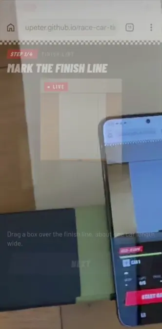

# race-car-timer

A lap timer for small remote-controlled cars. A phone above the track watches
the finish line through its camera and counts the laps of each car.

<p align="center">
  
</p>

Open on the phone (Chrome, Android): https://upeter.github.io/race-car-timer/
A phone needs the HTTPS address. Plain `http://` on the local network gives no
camera.

## What you need

- A phone fixed above the track, camera pointing straight down at the finish
  line.
- A colour sticker on the roof of each car (maximum 4 cars), for example a
  coloured sticky note. Use colours that differ clearly from each other and
  from the floor. On a wood floor use pink, green and blue, not orange or
  yellow.
- Car bodies that do not have the colour of a sticker.
- Good, even light.
- Turn off auto-rotate before you mount the phone.

## Setup

Setup is a wizard: one step per screen, with **Next** and **Back**.

1. **Mark the finish line**: drag a box over the finish line, about one car
   length wide. Drawing a new box later removes the cars.
2. **Clear the track**: take all cars out of the box and press
   **Capture empty track**. When you come back to this step, **Keep it** skips
   it.
3. **Cars**: put one car on the finish line and press **Add car**. Repeat for
   each car (maximum 4), then press **Done with cars**. The bar next to a car
   shows how well the camera sees its sticker; the white mark is the level at
   which a crossing counts. If the camera does not find the sticker, the
   button **Camera missed it? Tap the sticker** appears: press it and tap the
   sticker in the picture.
4. **Choose the session**: **Practice** or **Race** (with a number of laps).
5. **Grid is set**: check the cars and press **Lights out** to start.

A stored setup opens on the last screen. **Edit setup** goes back to step 1,
**Clear** removes the zone, the empty-track picture and all cars.

If a pass is not counted, add light or use a larger sticker first. Changing the
colour tolerance in Settings removes the cars, so they must be added again.

## Modes

- **Practice**: a car's clock starts on its first crossing. Each later
  crossing is a lap.
- **Race**: cars start behind the line. Press **Start race** for the
  countdown; after it, each crossing is a lap. A car finishes at the lap
  target. **Stop** ends the race early, **New race** starts another.

The results show at the bottom of the screen, one card per car with the
sticker colour the camera saw. After a race, a podium shows the first three
with their gaps.

## Development

No build step and no dependencies.

```bash
npm test                    # unit tests (Node 20 or later)
python3 -m http.server 8000 # then open http://localhost:8000/
```

The design is in `docs/superpowers/specs/2026-11-21-lap-timer-design.md`.
